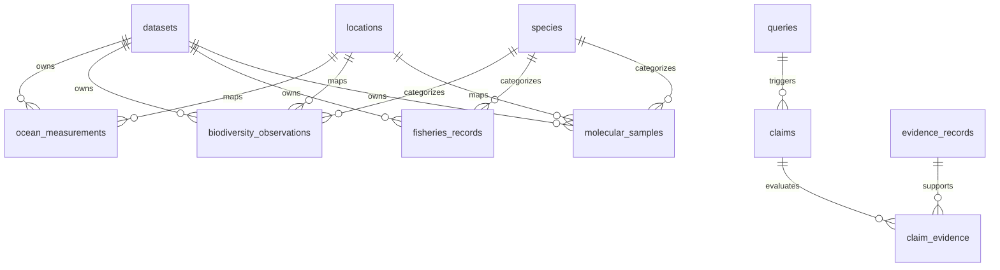
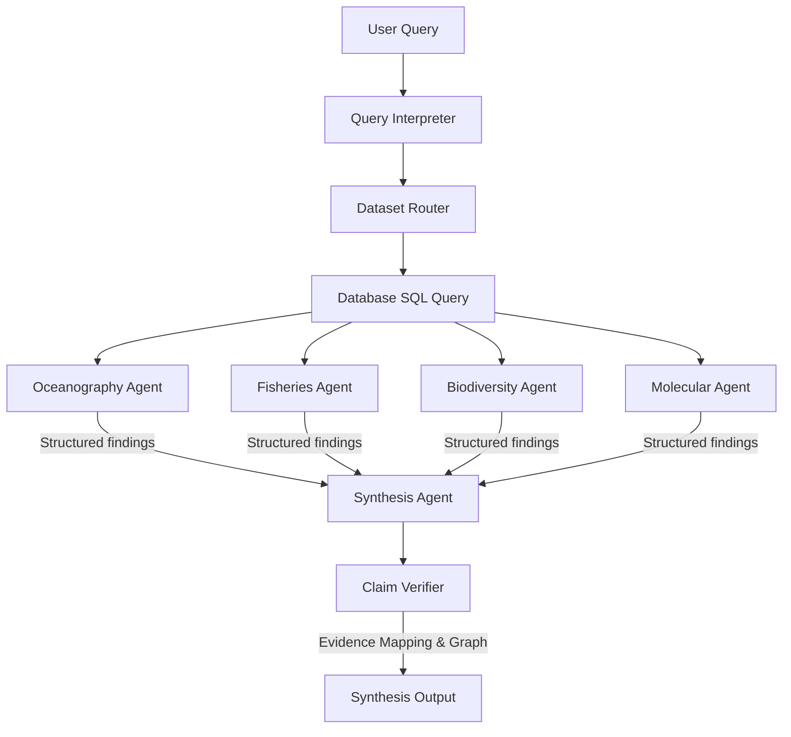
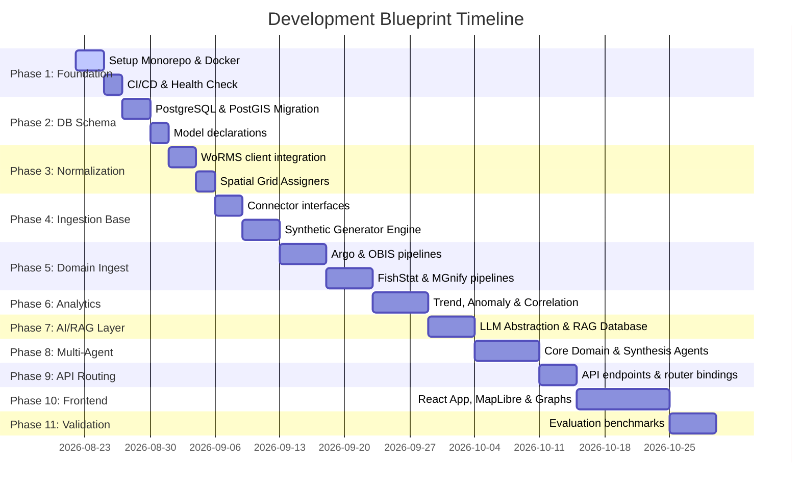

# Engineering Implementation PRD: Unified Marine Intelligence & Ecosystem Reasoning Platform

This document is the phase-wise engineering implementation specification for building the **Unified Marine Intelligence & Ecosystem Reasoning Platform**. It details the exact repository structure, database schemas, code architectures, ingestion pipelines, analytics formulas, agent communication formats, API endpoints, and frontend components required to build the platform.

---

## Repository Structure

The project is structured as a monorepo to ensure tight integration between backend services, database migrations, frontend UI, data snapshots, and verification tests.

```text
marine-intelligence/
├── backend/
│   ├── app/
│   │   ├── __init__.py
│   │   ├── main.py                # FastAPI entry point
│   │   ├── config.py              # Application configuration & Pydantic settings
│   │   ├── api/
│   │   │   ├── __init__.py
│   │   │   ├── router.py          # Master API router
│   │   │   └── routes/
│   │   │       ├── query.py       # Query execution, RAG, and Agent orchestration
│   │   │       ├── datasets.py    # Ingestion status and dataset registry metadata
│   │   │       ├── ocean.py       # Raw and aggregated oceanographic metrics
│   │   │       ├── biodiversity.py# Species distribution and trend metrics
│   │   │       ├── fisheries.py   # FAO fisheries landing records
│   │   │       └── molecular.py   # MGnify sample analysis and taxonomic profiles
│   │   ├── database/
│   │   │   ├── __init__.py
│   │   │   ├── session.py         # SQLAlchemy engine and session management
│   │   │   ├── base.py            # Base declarative model import list
│   │   │   └── models/
│   │   │       ├── core.py        # Shared entities: datasets, locations, species
│   │   │       ├── measurements.py# Domain-specific measurements (ocean, bio, fish, mol)
│   │   │       └── reasoning.py   # Agent-generated queries, claims, and evidence
│   │   ├── ingestion/
│   │   │   ├── __init__.py
│   │   │   ├── base.py            # DatasetConnector base class definition
│   │   │   ├── argo/
│   │   │   │   ├── downloader.py  # FTP/HTTP fetching of Argo netCDF files
│   │   │   │   ├── parser.py      # NetCDF variables extraction (temperature, salinity)
│   │   │   │   └── transformer.py # Map to Unified Observation Model
│   │   │   ├── obis/
│   │   │   │   ├── client.py      # OBIS API wrapper
│   │   │   │   └── transformer.py # Map occurrences to Unified Observation Model
│   │   │   ├── fishstat/
│   │   │   │   ├── parser.py      # CSV parser for FAO FishStat data
│   │   │   │   └── transformer.py # Map catch statistics to Fisheries records
│   │   │   ├── mgnify/
│   │   │   │   ├── client.py      # MGnify REST API client for taxonomy profiles
│   │   │   │   └── transformer.py # Map metabarcoding profiles to Molecular samples
│   │   │   └── worms/
│   │   │       └── client.py      # WoRMS AphiaID SOAP/REST taxonomy resolver
│   │   ├── analytics/
│   │   │   ├── __init__.py
│   │   │   ├── engine.py          # Deterministic computations (trends, correlation)
│   │   │   ├── spatial.py         # Spatial aggregation, density, and grid joins
│   │   │   └── anomaly.py         # Outlier and z-score baseline calculators
│   │   ├── agents/
│   │   │   ├── __init__.py
│   │   │   ├── base.py            # Agent prompt framework and executor
│   │   │   ├── provider.py        # Gemini API / LLM abstraction layer
│   │   │   ├── oceanography.py    # Ocean analytics agent
│   │   │   ├── fisheries.py       # Landings and fishing pressure agent
│   │   │   ├── biodiversity.py    # Species range and population agent
│   │   │   ├── molecular.py       # Metagenomic profiles agent
│   │   │   └── synthesis.py       # Evidence fusion and final answer synthesis
│   │   └── tests/
│   │       ├── conftest.py
│   │       ├── test_ingestion.py
│   │       ├── test_analytics.py
│   │       ├── test_agents.py
│   │       └── test_api.py
│   ├── Dockerfile
│   ├── requirements.txt
│   └── alembic.ini                # Schema migration configurations
│
├── frontend/
│   ├── public/
│   ├── src/
│   │   ├── assets/
│   │   ├── components/
│   │   │   ├── MapViewer.tsx      # MapLibre GL JS spatial analytics layer
│   │   │   ├── EcosystemGraph.tsx # Force-directed claim-evidence relationship graph
│   │   │   ├── AnalyticsChart.tsx # Recharts for trend and scatter plots
│   │   │   ├── AgentChat.tsx      # Query inputs and conversational layout
│   │   │   └── Common/            # Loading animations, buttons, table units
│   │   ├── pages/
│   │   │   ├── Dashboard.tsx      # Master system stats and data status
│   │   │   ├── Explorer.tsx       # Combined domain dashboard map + chart views
│   │   │   └── InsightViewer.tsx  # Deep dive into agent claims, evidence, and scores
│   │   ├── hooks/
│   │   │   └── useQuery.ts        # Custom API integration hooks
│   │   ├── services/
│   │   │   └── api.ts             # Axios HTTP client configurations
│   │   ├── types/
│   │   │   └── index.ts           # Shared TypeScript interfaces
│   │   ├── App.tsx
│   │   ├── index.css              # Custom styling definitions
│   │   └── main.tsx
│   ├── package.json
│   ├── tsconfig.json
│   └── vite.config.ts
│
├── data/
│   ├── raw/                       # Cached network downloads (ignored by Git)
│   ├── processed/                 # Normalization output logs (ignored by Git)
│   ├── demo/                      # Deterministic synthetic data templates
│   └── metadata/                  # CSV/JSON definition files for regions and keys
│
├── evaluation/
│   ├── questions.json             # Benchmark test queries
│   ├── expected_claims.json       # Ground-truth claim boundaries
│   └── run_benchmarks.py          # Quantitative evaluation harness
│
├── scripts/
│   ├── ingest_all.py              # Sequential master ingest runner
│   ├── generate_demo_data.py      # Synthetic database generator
│   └── seed_database.py           # Database baseline content loader
│
├── docs/
│   ├── architecture.md
│   └── api.md
│
├── docker-compose.yml             # Integrates backend, frontend, and db
├── .env.example
├── README.md
└── Makefile                       # Unified terminal entry point
```

---

## Database Architecture (PostgreSQL + PostGIS)

A single relational database is the primary store for normalized physical variables, taxonomic records, geographic locations, and agent auditing records.

### Schema Relationships Diagram



### Database Schema DDL

```sql
-- Enable PostGIS extension for spatial index queries
CREATE EXTENSION IF NOT EXISTS postgis;

-- 1. DATASETS REGISTRY
CREATE TABLE datasets (
    id VARCHAR(50) PRIMARY KEY,
    name VARCHAR(100) NOT NULL,
    domain VARCHAR(50) NOT NULL, -- 'oceanography', 'fisheries', 'biodiversity', 'molecular'
    description TEXT,
    source_url VARCHAR(255),
    license VARCHAR(100),
    version VARCHAR(50),
    retrieved_at TIMESTAMP WITH TIME ZONE DEFAULT CURRENT_TIMESTAMP,
    metadata JSONB DEFAULT '{}'::jsonb
);

-- 2. SPECIES (WoRMS Normalized Reference Layer)
CREATE TABLE species (
    id SERIAL PRIMARY KEY,
    aphia_id INTEGER UNIQUE,
    scientific_name VARCHAR(150) NOT NULL,
    canonical_name VARCHAR(150) NOT NULL,
    common_name VARCHAR(150),
    kingdom VARCHAR(50),
    phylum VARCHAR(50),
    class VARCHAR(50),
    "order" VARCHAR(50),
    family VARCHAR(50),
    genus VARCHAR(50),
    species VARCHAR(100),
    taxonomy_json JSONB DEFAULT '{}'::jsonb
);

-- 3. LOCATIONS (Spatial Grid Cell Layer)
CREATE TABLE locations (
    id SERIAL PRIMARY KEY,
    latitude NUMERIC(8, 5) NOT NULL,
    longitude NUMERIC(8, 5) NOT NULL,
    grid_cell_id VARCHAR(50) NOT NULL, -- e.g., 'G_18_72' based on grid resolution
    region_id VARCHAR(50) NOT NULL,    -- e.g., 'Arabian_Sea'
    geometry GEOMETRY(Point, 4326) NOT NULL,
    CONSTRAINT unique_lat_lon UNIQUE (latitude, longitude)
);

CREATE INDEX idx_locations_geometry ON locations USING gist(geometry);
CREATE INDEX idx_locations_grid_cell ON locations(grid_cell_id);

-- 4. OCEANOGRAPHIC MEASUREMENTS
CREATE TABLE ocean_measurements (
    id BIGSERIAL PRIMARY KEY,
    dataset_id VARCHAR(50) REFERENCES datasets(id) ON DELETE CASCADE,
    location_id INTEGER REFERENCES locations(id),
    timestamp TIMESTAMP WITH TIME ZONE NOT NULL,
    depth_m NUMERIC(6, 2) NOT NULL,
    variable VARCHAR(50) NOT NULL, -- 'temperature', 'salinity', 'oxygen', 'chlorophyll'
    value NUMERIC(10, 4) NOT NULL,
    unit VARCHAR(20) NOT NULL,
    quality_flag VARCHAR(20) DEFAULT 'valid',
    source_record_id VARCHAR(100),
    metadata JSONB DEFAULT '{}'::jsonb
);

CREATE INDEX idx_ocean_measurements_query ON ocean_measurements(variable, timestamp);
CREATE INDEX idx_ocean_measurements_location ON ocean_measurements(location_id);

-- 5. BIODIVERSITY OBSERVATIONS (OBIS Format)
CREATE TABLE biodiversity_observations (
    id BIGSERIAL PRIMARY KEY,
    dataset_id VARCHAR(50) REFERENCES datasets(id) ON DELETE CASCADE,
    species_id INTEGER REFERENCES species(id),
    location_id INTEGER REFERENCES locations(id),
    timestamp TIMESTAMP WITH TIME ZONE NOT NULL,
    depth_m NUMERIC(6, 2),
    observation_type VARCHAR(50) NOT NULL, -- 'occurrence', 'abundance_count', 'biomass'
    abundance NUMERIC(12, 4),
    count INTEGER,
    source_record_id VARCHAR(100),
    metadata JSONB DEFAULT '{}'::jsonb
);

CREATE INDEX idx_biodiversity_obs_species ON biodiversity_observations(species_id);
CREATE INDEX idx_biodiversity_obs_time_loc ON biodiversity_observations(location_id, timestamp);

-- 6. FISHERIES RECORDS (FAO FishStat Statistics)
CREATE TABLE fisheries_records (
    id BIGSERIAL PRIMARY KEY,
    dataset_id VARCHAR(50) REFERENCES datasets(id) ON DELETE CASCADE,
    species_id INTEGER REFERENCES species(id),
    region_id VARCHAR(50) NOT NULL,
    year INTEGER NOT NULL,
    catch NUMERIC(12, 3),          -- Landings weight in tonnes
    production NUMERIC(12, 3),     -- Aquaculture yield
    unit VARCHAR(20) DEFAULT 'tonnes',
    source_record_id VARCHAR(100),
    metadata JSONB DEFAULT '{}'::jsonb
);

CREATE INDEX idx_fisheries_query ON fisheries_records(species_id, region_id, year);

-- 7. MOLECULAR BIODIVERSITY SAMPLES (MGnify Metabarcoding profiles)
CREATE TABLE molecular_samples (
    id BIGSERIAL PRIMARY KEY,
    dataset_id VARCHAR(50) REFERENCES datasets(id) ON DELETE CASCADE,
    sample_identifier VARCHAR(100) NOT NULL,
    location_id INTEGER REFERENCES locations(id),
    timestamp TIMESTAMP WITH TIME ZONE NOT NULL,
    species_id INTEGER REFERENCES species(id),
    abundance NUMERIC(8, 6),       -- Relative abundance (ratio 0.0 to 1.0)
    measurement_type VARCHAR(50) DEFAULT 'metabarcoding_amplicon',
    value NUMERIC(10, 4),          -- OTU count or reading index
    unit VARCHAR(20) DEFAULT 'reads_ratio',
    source_record_id VARCHAR(100),
    metadata JSONB DEFAULT '{}'::jsonb
);

CREATE INDEX idx_molecular_samples_lookup ON molecular_samples(species_id, location_id);

-- 8. QUERY LOGS
CREATE TABLE queries (
    id UUID PRIMARY KEY,
    user_query TEXT NOT NULL,
    structured_query JSONB NOT NULL,
    created_at TIMESTAMP WITH TIME ZONE DEFAULT CURRENT_TIMESTAMP
);

-- 9. CLAIMS (Agent Atomic Findings)
CREATE TABLE claims (
    id UUID PRIMARY KEY,
    query_id UUID REFERENCES queries(id) ON DELETE CASCADE,
    claim_text TEXT NOT NULL,
    claim_type VARCHAR(50) NOT NULL, -- 'trend', 'anomaly', 'correlation', 'association'
    status VARCHAR(50) NOT NULL,     -- 'supported', 'partially_supported', 'contradicted', 'insufficient_evidence'
    confidence NUMERIC(3, 2) NOT NULL
);

-- 10. EVIDENCE RECORDS
CREATE TABLE evidence_records (
    id UUID PRIMARY KEY,
    query_id UUID REFERENCES queries(id) ON DELETE CASCADE,
    source_type VARCHAR(50) NOT NULL, -- 'database_record', 'publication_reference', 'derived_analysis'
    source_id VARCHAR(100),
    evidence_text TEXT NOT NULL,
    numeric_value NUMERIC(12, 4),
    method VARCHAR(100),
    confidence NUMERIC(3, 2) NOT NULL,
    metadata JSONB DEFAULT '{}'::jsonb
);

-- 11. CLAIM-EVIDENCE RELATIONSHIP BRIDGE
CREATE TABLE claim_evidence (
    id SERIAL PRIMARY KEY,
    claim_id UUID REFERENCES claims(id) ON DELETE CASCADE,
    evidence_id UUID REFERENCES evidence_records(id) ON DELETE CASCADE,
    relationship VARCHAR(50) NOT NULL, -- 'supported_by', 'contradicted_by', 'derived_from'
    weight NUMERIC(3, 2) DEFAULT 1.00
);
```

---

## Normalization Core Systems

### Taxonomic Normalization
To prevent naming collisions (e.g., mismatching synonyms like "T. albacares" vs "Yellowfin Tuna"), the platform queries the World Register of Marine Species (WoRMS) REST API to fetch canonical species data.

```python
# backend/app/services/taxonomy_service.py
import httpx
from typing import Optional, Dict, Any

class TaxonomyService:
    def __init__(self, db_session):
        self.client = httpx.Client(base_url="https://www.marinespecies.org/rest")
        self.db = db_session

    def resolve_taxon(self, raw_name: str) -> Optional[Dict[str, Any]]:
        # 1. Clean string name
        clean_name = raw_name.strip()
        
        # 2. Check local DB cache first to avoid hitting rate-limited API
        cached = self.db.query(SpeciesModel).filter(
            (SpeciesModel.scientific_name.ilike(clean_name)) | 
            (SpeciesModel.common_name.ilike(clean_name))
        ).first()
        if cached:
            return cached.to_dict()

        # 3. Hit WoRMS API
        try:
            response = self.client.get(f"/AphiaIDByName/{clean_name}", params={"marine_only": True})
            if response.status_code != 200:
                return None
            
            aphia_id = response.json()
            if not aphia_id:
                return None
            
            record_res = self.client.get(f"/AphiaRecordByAphiaID/{aphia_id}")
            if record_res.status_code == 200:
                data = record_res.json()
                
                taxon_details = {
                    "aphia_id": aphia_id,
                    "scientific_name": data.get("scientificname"),
                    "canonical_name": data.get("valid_name"),
                    "common_name": clean_name if clean_name.lower() != data.get("scientificname").lower() else data.get("vernacular"),
                    "kingdom": data.get("kingdom"),
                    "phylum": data.get("phylum"),
                    "class": data.get("class"),
                    "order": data.get("order"),
                    "family": data.get("family"),
                    "genus": data.get("genus"),
                    "species": data.get("valid_name").split(" ")[-1] if data.get("valid_name") else None,
                    "taxonomy_json": data
                }
                
                new_species = SpeciesModel(**taxon_details)
                self.db.add(new_species)
                self.db.commit()
                return taxon_details
        except Exception as e:
            print(f"WoRMS resolving failed: {str(e)}")
            return None
```

### Spatial Normalization
Geospatial coordinate values from varying observation instruments (floats, cruise logs, nets) are aggregated into a standardized spatial resolution. The system builds a configurable degrees grid (defaults to `0.25° x 0.25°`).

```python
# backend/app/services/spatial_service.py
import math

class SpatialService:
    def __init__(self, grid_size: float = 0.25):
        self.grid_size = grid_size

    def compute_grid_cell(self, lat: float, lon: float) -> str:
        """
        Calculates the center coordinate bounding ID for a coordinate point.
        Example: lat=18.92, lon=72.82 -> grid_cell_id = 'G_18.875_72.875'
        """
        grid_lat = (math.floor(lat / self.grid_size) * self.grid_size) + (self.grid_size / 2)
        grid_lon = (math.floor(lon / self.grid_size) * self.grid_size) + (self.grid_size / 2)
        return f"G_{round(grid_lat, 4)}_{round(grid_lon, 4)}"

    def resolve_region(self, lat: float, lon: float) -> str:
        """
        Determines target region based on simple bounding coordinates for the MVP.
        """
        if 10.0 <= lat <= 25.0 and 60.0 <= lon <= 77.0:
            return "Arabian_Sea"
        return "Unknown_Region"
```

---

## Data Ingestion Architecture

Each ingestion pipe uses a custom data connector subclassing a unified interface. No pipeline script should process dataset files entirely in RAM; raw datasets must be downloaded to disk and read using iterative streams (such as chunked file buffers or pagination payloads).

```python
# backend/app/ingestion/base.py
from abc import ABC, abstractmethod
from typing import Generator, Dict, Any, List

class DatasetConnector(ABC):
    def __init__(self, dataset_id: str, db_session):
        self.dataset_id = dataset_id
        self.db = db_session

    @abstractmethod
    def download(self, config: Dict[str, Any]) -> str:
        """
        Downloads data files to disk path. Returns path to local source.
        """
        pass

    @abstractmethod
    def validate(self, filepath: str) -> bool:
        """
        Executes layout validation checks. Returns true if correct.
        """
        pass

    @abstractmethod
    def transform(self, filepath: str) -> Generator[Dict[str, Any], None, None]:
        """
        Iterates over rows of source file, translating items to standard model schemas.
        """
        pass

    @abstractmethod
    def load(self, records: Generator[Dict[str, Any], None, None]) -> Dict[str, Any]:
        """
        Ingests records into DB in batches. Returns execution report details.
        """
        pass
```

### Dataset Connectivity Fallback System
To protect execution logic when external services fail, ingestion pipelines support three distinct source execution configurations, controlled using `.env` options:

1. **Mode A — Live Ingestion**: Live downloading using API endpoints directly.
2. **Mode B — Local Cache Ingestion**: Scans the regional snapshot directory `data/raw/` for downloaded target files instead of hitting the live APIs.
3. **Mode C — Deterministic Synthetic Data**: Uses custom generative formulas to spawn simulated coordinates, timestamps, and parameters representing localized events (e.g. simulated temperature spikes paired with population contractions).

---

## Scientific Analytics Engine

Calculations on observations must remain deterministic. Large Language Models (LLMs) must **never** be used for raw statistical or mathematical queries.

```python
# backend/app/analytics/engine.py
import pandas as pd
import numpy as np
from scipy import stats
from typing import Dict, Any, List

class ScientificAnalyticsEngine:
    
    @staticmethod
    def calculate_trend(timestamps: List[Any], values: List[float]) -> Dict[str, Any]:
        """
        Returns basic summary metrics and simple linear regression trends over time.
        """
        if not values or len(values) < 2:
            return {"mean": 0, "median": 0, "slope": 0, "p_value": 1.0, "percentage_change": 0.0}
        
        df = pd.DataFrame({"time": pd.to_datetime(timestamps), "val": values})
        df = df.sort_values("time")
        
        time_seconds = (df["time"] - df["time"].min()).dt.total_seconds()
        slope, intercept, r_value, p_value, std_err = stats.linregress(time_seconds, df["val"])
        
        mean_val = df["val"].mean()
        median_val = df["val"].median()
        min_val = df["val"].min()
        max_val = df["val"].max()
        
        pct_change = 0.0
        if df["val"].iloc[0] != 0:
            pct_change = ((df["val"].iloc[-1] - df["val"].iloc[0]) / df["val"].iloc[0]) * 100.0

        return {
            "mean": float(mean_val),
            "median": float(median_val),
            "min": float(min_val),
            "max": float(max_val),
            "slope": float(slope),
            "slope_per_decade": float(slope * 86400 * 365.25 * 10),
            "r_squared": float(r_value ** 2),
            "p_value": float(p_value),
            "percentage_change": float(pct_change)
        }

    @staticmethod
    def calculate_correlation(values_x: List[float], values_y: List[float]) -> Dict[str, Any]:
        """
        Evaluates Pearson and Spearman rankings for two parameter arrays of equal length.
        """
        if len(values_x) != len(values_y) or len(values_x) < 3:
            return {"pearson_r": 0.0, "pearson_p": 1.0, "spearman_r": 0.0, "spearman_p": 1.0}
            
        pearson_r, pearson_p = stats.pearsonr(values_x, values_y)
        spearman_r, spearman_p = stats.spearmanr(values_x, values_y)
        
        return {
            "pearson": {"r": float(pearson_r), "p": float(pearson_p)},
            "spearman": {"r": float(spearman_r), "p": float(spearman_p)},
            "sample_count": len(values_x)
        }

    @staticmethod
    def detect_anomalies(values: List[float], timestamps: List[Any], window: int = 12) -> List[Dict[str, Any]]:
        """
        Calculates rolling median baselines and identifies statistical outliers using z-score thresholding.
        """
        if len(values) < window:
            return []
            
        df = pd.DataFrame({"time": pd.to_datetime(timestamps), "val": values}).sort_values("time")
        
        df["rolling_mean"] = df["val"].rolling(window=window, min_periods=3).mean()
        df["rolling_std"] = df["val"].rolling(window=window, min_periods=3).std()
        df["z_score"] = (df["val"] - df["rolling_mean"]) / df["rolling_std"].replace(0, np.nan)
        
        anomalies = df[df["z_score"].abs() > 2.5]
        
        results = []
        for idx, row in anomalies.iterrows():
            results.append({
                "timestamp": row["time"].isoformat(),
                "observed_value": float(row["val"]),
                "expected_mean": float(row["rolling_mean"]),
                "z_score": float(row["z_score"]),
                "classification": "high" if row["z_score"] > 0 else "low"
            })
        return results
```

---

## Agentic AI Reasoning Layer

The AI system is built as a collaborative multi-agent architecture using specialized analytical agents coordinated by a Synthesis Agent.

### Agent Network Topology



### Agent Configuration & System Prompts

Each agent receives an explicit system prompt mapping its role to its data-querying capabilities.

#### 1. Oceanography Agent
- **System Prompt**: 
  > You are a marine oceanography researcher. Your role is to examine oceanographic variables (water temperature, salinity, oxygen, and chlorophyll levels) across spatial grids and time windows. You access database views using queries. You must report exact variables, depth ranges, computed slopes, and anomaly points. Never speculate about species dynamics; only describe physical variables.
- **Enabled Tools**: `get_ocean_measurements`, `calculate_ocean_trend`, `calculate_ocean_anomaly`.

#### 2. Fisheries Agent
- **System Prompt**: 
  > You are a fisheries stock analyst. Your role is to evaluate commercial landings, catch metrics, and aquaculture production statistics. You investigate spatial regions and years to determine trends in fishing pressures. Do not speculate about environmental changes; only report harvesting trends.
- **Enabled Tools**: `get_fisheries_records`, `calculate_fisheries_trend`, `compare_fisheries_periods`.

#### 3. Biodiversity Agent
- **System Prompt**: 
  > You are a marine biodiversity conservation specialist. Your role is to track species distributions, occurrences, and relative counts across geographic areas. You report species location maps and trends over time. Never report physical variables; only report species presence and density metrics.
- **Enabled Tools**: `get_species_observations`, `get_species_distribution`, `calculate_biodiversity_trend`.

#### 4. Molecular Biodiversity Agent
- **System Prompt**: 
  > You are a marine genomicist. Your role is to assess metabarcoding, amplicon readings, and molecular OTU abundances to evaluate microscopic diversity. You identify community profiles and biodiversity shifts.
- **Enabled Tools**: `get_molecular_samples`, `get_taxonomic_profile`, `compare_molecular_profiles`.

#### 5. Synthesis Agent
- **System Prompt**: 
  > You are the lead coordinator and evidence integration agent. You receive structured findings from domain agents and synthesize them into a coherent answer. You must:
  > 1. Extract atomic claims from the domain agents' findings.
  > 2. Build the evidence graph mapping claims to physical observations.
  > 3. Verify each claim against the retrieved evidence (flagging claims as supported, partially_supported, contradicted, or insufficient_evidence).
  > 4. Guard against converting correlation into causation. 
  > 5. Compute the final confidence score based on the evidence.
- **Enabled Tools**: None (Internal reasoning engine).

### Agent Structured Communication Schema
Agents communicate using structured JSON objects. This constraint ensures downstream processes parse evidence tables and claim variables reliably.

```json
{
  "agent": "oceanography",
  "findings": [
    {
      "claim": "Regional mean temperature increased by 0.9°C.",
      "value": 0.9,
      "unit": "degC",
      "method": "linear trend",
      "confidence": 0.91
    }
  ],
  "evidence": [
    {
      "source": "Argo",
      "record_ids": ["OM_991823", "OM_991824"],
      "description": "Arabian Sea float profiles (0-50m depth)"
    }
  ]
}
```

### Claim-Level Reasoning & Confidence Model

The Synthesis Agent breaks the consolidated response down into atomic claims and evaluates the validity of each claim against the database records.

```python
# backend/app/agents/synthesis.py
from typing import List, Dict, Any

class SynthesisEngine:
    
    @staticmethod
    def calculate_confidence(
        source_quality: float, 
        evidence_support: float, 
        cross_domain_support: float,
        data_completeness: float, 
        analysis_quality: float
    ) -> float:
        """
        Calculates a configurable weighted confidence score.
        All weights sum to 1.0.
        """
        weights = {
            "source_quality": 0.30,
            "evidence_support": 0.25,
            "cross_domain_support": 0.20,
            "data_completeness": 0.15,
            "analysis_quality": 0.10
        }
        
        score = (
            (source_quality * weights["source_quality"]) +
            (evidence_support * weights["evidence_support"]) +
            (cross_domain_support * weights["cross_domain_support"]) +
            (data_completeness * weights["data_completeness"]) +
            (analysis_quality * weights["analysis_quality"])
        )
        return round(score, 2)
```

---

## API Design (FastAPI)

### Unified Query System
- **Endpoint**: `POST /api/query`
- **Request Body**:
```json
{
  "question": "Why has yellowfin tuna changed in the Arabian Sea?"
}
```
- **Response Body**:
```json
{
  "query_id": "8f2d7b56-3c4a-4e2b-8a5f-9e7c3b2f1d4a",
  "answer": "Yellowfin tuna abundance has decreased by 15% in the Arabian Sea since 2021. Deterministic analytics show a negative correlation (r = -0.72) with a 0.9°C increase in sea surface temperature. The data support an association, but do not establish causation.",
  "confidence": "Medium",
  "confidence_score": 0.74,
  "claims": [
    {
      "claim_id": "c1",
      "text": "Sea surface temperature increased by 0.9°C",
      "status": "supported",
      "confidence": 0.91
    },
    {
      "claim_id": "c2",
      "text": "Yellowfin tuna occurrence frequency decreased by 15%",
      "status": "supported",
      "confidence": 0.85
    },
    {
      "claim_id": "c3",
      "text": "Temperature change caused the yellowfin tuna decline",
      "status": "insufficient_evidence",
      "confidence": 0.20
    }
  ],
  "evidence": [
    {
      "evidence_id": "e1",
      "source_dataset": "argo",
      "evidence_text": "Mean surface layer temperature increased from 27.5°C to 28.4°C during 2021-2025.",
      "record_count": 12481,
      "method": "Linear regression slope analysis"
    },
    {
      "evidence_id": "e2",
      "source_dataset": "obis",
      "evidence_text": "Thunnus albacares occurrence density decreased from 4.2 observations/grid to 3.5.",
      "record_count": 3410,
      "method": "Spatial grid cell density aggregation"
    }
  ],
  "claim_evidence_links": [
    {"claim_id": "c1", "evidence_id": "e1", "relationship": "supported_by"},
    {"claim_id": "c2", "evidence_id": "e2", "relationship": "supported_by"},
    {"claim_id": "c3", "evidence_id": "e1", "relationship": "derived_from"},
    {"claim_id": "c3", "evidence_id": "e2", "relationship": "derived_from"}
  ],
  "visualizations": [
    {
      "type": "scatter_plot",
      "title": "Temperature vs. Yellowfin Tuna Abundance",
      "x_axis": "Temperature (°C)",
      "y_axis": "Abundance (count/grid)",
      "data": [
        {"x": 27.5, "y": 4.2},
        {"x": 28.0, "y": 3.9},
        {"x": 28.4, "y": 3.5}
      ]
    }
  ]
}
```

---

## Phase-Wise Implementation Roadmap



### Phase 1: Foundations & Monorepo Configuration
Initialize the monorepo workspace. Build basic development containers (FastAPI, React, PostgreSQL/PostGIS) and ensure they spin up using a single terminal command.

- **Initialization Commands**:
  ```bash
  # Initialize frontend
  npx -y create-vite-app@latest frontend --template react-ts
  # Initialize backend environment
  cd backend && python -m venv venv
  ```
- **Verification Milestone**: Running `docker compose up --build` launches the Vite server, FastAPI framework, and PostgreSQL instances successfully.

### Phase 2: Schema Migrations & SQLAlchemy Models
Write migrations to build the tables in the database. Ensure spatial indexes are enabled on geography nodes.

- **Tasks**:
  1. Write python declarations in `backend/app/database/models/`.
  2. Run `alembic init alembic` to manage SQL upgrades.
  3. Verify with script queries that mock spatial locations can be stored and retrieved using bounding box geometry coordinates.

### Phase 3: Normalization Core Engines
Build translation mechanisms to map varying inputs into a single standard coordinate and naming space.

- **Tasks**:
  1. Build the WoRMS taxonomy resolver with HTTP network caching.
  2. Implement coordinate grid conversions (translating lat/lon inputs into `grid_cell_id`).
  3. Unit test that "Thunnus albacares" matches both "Yellowfin Tuna" and "T. albacares" records correctly.

### Phase 4: Ingestion Base & Synthetic Generator
Build fallback pathways to ensure the project runs offline or in isolated demonstration environments.

- **Tasks**:
  1. Define the base `DatasetConnector` class.
  2. Create a deterministic synthetic generator script (`generate_demo_data.py`) with a fixed seed (`seed=42`).
  3. Ensure the generator creates mock tables showing a temperature increase of `0.9°C` alongside a `15%` decrease in species counts within the Arabian Sea coordinate blocks.

### Phase 5: Ingest Pipelines (Argo, OBIS, FishStat, MGnify)
Build ETL loaders for each of the four target data domains.

- **Tasks**:
  1. **Argo**: Extract NetCDF temperature/salinity profiles using Python's `netCDF4` library.
  2. **OBIS**: Pull occurrence logs from the OBIS REST API.
  3. **FishStat**: Parse landing weight datasets.
  4. **MGnify**: Read OTU relative abundance profiles.
  5. Include data quality auditing logs (rows processed, failures, coordinate errors) for each ingestion run.

### Phase 6: Deterministic Scientific Analytics
Implement calculations for trends, anomalies, and correlations.

- **Tasks**:
  1. Write math calculations using Pandas and SciPy (no LLM logic).
  2. Code Pearson/Spearman correlation models.
  3. Build z-score rolling threshold models to flag temperature anomalies.
  4. Write backend unit tests verifying trend statistics against hand-calculated datasets.

### Phase 7: AI Provider Abstraction & RAG
Build the text search database and LLM interface layers.

- **Tasks**:
  1. Write the `LLMProvider` interface to abstract the generative AI provider (using the Gemini API).
  2. Build text-based search (using PGVector or simplified SQL search patterns over metadata tables) to support RAG context retrieval.
  3. Parse natural language prompts into structured query objects using Pydantic JSON targets.

### Phase 8: Multi-Agent Logic & Synthesis Layer
Orchestrate domain agents to generate structured claims.

- **Tasks**:
  1. Write prompts and validation parsers for the Oceanography, Fisheries, Biodiversity, and Molecular agents.
  2. Create the Synthesis Agent to consolidate observations, verify claims against the evidence, and compute final confidence scores.

### Phase 9: FastAPI Routers & Controller Endpoints
Expose core features using REST API endpoints.

- **Tasks**:
  1. Expose query execution under `POST /api/query`.
  2. Build endpoints for detailed data views: `GET /api/ocean/measurements`, `GET /api/species/{id}/trend`, and `GET /api/query/{id}/evidence`.
  3. Generate interactive OpenAPI documentation pages under `/docs`.

### Phase 10: React Frontend Dashboard & Interactive Graphs
Build the user interface.

- **Tasks**:
  1. Use Vite, TypeScript, and CSS variables for a dark-themed UI.
  2. Add MapLibre GL JS to display temperature heatmaps and occurrence markers.
  3. Use Recharts to plot scatter and line charts.
  4. Build an interactive node-edge visualization to render the claim-evidence graph.

### Phase 11: Benchmark Testing & Evaluation
Evaluate the accuracy of the platform.

- **Tasks**:
  1. Write 30 target queries across oceanography, fisheries, biodiversity, molecular, and cross-domain questions.
  2. Create `evaluation/run_benchmarks.py` to compare agent answers against expected sources and forbidden claims.
  3. Measure precision, recall, and unsupported claim rates to ensure grounding.

### Phase 12: Deployment & Optimization
Prepare the application for production.

- **Tasks**:
  1. Set up Docker Compose configurations for deployment.
  2. Configure caching layers for API endpoints and taxonomy lookups.
  3. Run performance tests to ensure page loads meet targets.

---

## Evaluation Checklist & Success Metrics

The MVP is complete when the following metrics are met:

| Target Area | Metric | Standard for Acceptance | Verification Method |
| :--- | :--- | :--- | :--- |
| **Grounding** | Unsupported Claim Rate | Exactly `0.0%` (no fabricated facts/URLs) | `run_benchmarks.py` audits |
| **Taxonomy** | Resolution Synonyms | `> 95%` canonical matches | WoRMS API client test suite |
| **Performance**| API response time | Query DB `< 3s`, simple calculations `< 2s` | Load tests on local docker |
| **Offline** | Sandbox operations | `100%` functionality with `DEMO_MODE=true` | Running code without internet connection |
| **Security** | Secret auditing | Zero API keys in repository logs | Automated secret scanning |
